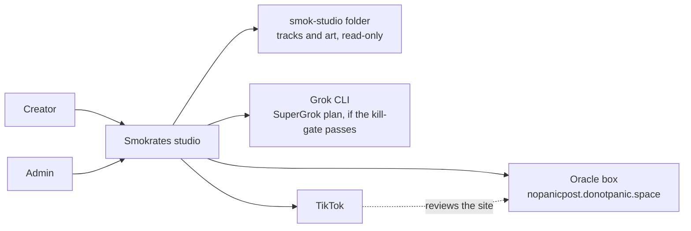
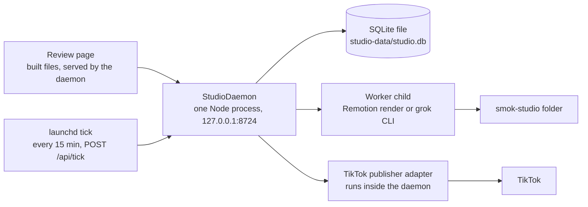

# Architecture

The map of the system. Update it in the same pull request that changes topology. History of a reversed choice lives in `docs/adr/`, marked superseded.

## What this is

The Smokrates studio makes short vertical videos for the Smokrates music project and sends them to TikTok. The Creator writes a week of up to seven nights by hand. Remotion renders each night as a 9:16 video. The Creator approves the week on one local review page. A launchd job then asks the daemon to send each approved night to the TikTok inbox. The Showrunner, Grok scenes and YouTube upload come in cycle 2.

The product is for one user on one laptop. It has no accounts and no public web page of its own. The pitch is in `docs/project-guidelines.md`.

## Status of each part

| Part | State |
| --- | --- |
| Remotion render of one track (TrackCard) | Exists |
| TikTok sign-in (PKCE) and inbox draft upload | Exists. Proven in the sandbox. |
| Public site on the Oracle box, and its deploy script | Exists |
| Review demo video (ReviewDemo) | Exists |
| StudioDaemon, SQLite store, jobs, migrations | Planned (cycle 1) |
| Review page | Planned (cycle 1) |
| Tick with publish rows and the 5-share cap | Planned (cycle 1) |
| Scene format | Planned (cycle 1), only if the Grok kill-gate passes |
| Showrunner, swap, Loop, Title, YouTube adapter | Deferred to cycle 2 |
| TikTok direct post | Later. Needs TikTok app review. |

## Context

People and external systems. C4 level 1. One box for this system.

Creator and Admin are the same person. The two names mark two kinds of work. Creator approves weeks and taps Post. Admin connects platforms and approves the man's canonical still.

## Containers

Processes, data stores, and how they talk. C4 level 2.

The daemon is the only writer. Workers are its children and report back to it. The browser has one hop only: the daemon. In development, Vite serves the page and proxies `/api` to the daemon.

| Container | What it does | State |
| --- | --- | --- |
| Review page | Shows the week as one comic page. Sends the Creator's choices to the API. | Planned |
| StudioDaemon | Serves the page and `/api`. Validates input. Owns the database, the job queue, the asset and render mutex, the tick and token refresh. Binds 127.0.0.1 only. | Planned |
| SQLite store | Source of truth for plans, episodes, assets, renders, jobs and publishes. Has a `schema_migrations` table. | Planned |
| Worker child | Renders an episode to a 9:16 mp4 with Remotion at concurrency 2, or runs the Grok CLI for a Scene. One at a time. | Render exists as a CLI (render-track). Planned as a child. |
| launchd tick | Calls `POST /api/tick` every 15 minutes. The daemon sends due, approved episodes. | Planned |
| TikTok publisher adapter | Inbox draft upload. | Exists. Planned as a daemon module. |

## Boundaries

- The browser talks only to the daemon. It never reads the database, the disk, or a platform.
- Only the daemon touches tokens. It is the only process that refreshes them. The API never returns a token. The connections list stats the token files and says connected or not.
- Tokens live in `.tiktok/` (`tokens.sandbox.json`, `tokens.production.json`) and `.youtube/`. Both folders are git-ignored. Files are mode 600.
- The smok-studio folder is read-only. The studio copies what it needs into ignored `public/media/<episodeId>/`.
- Generated pictures and clips go to ignored `assets/generated/`. Renders go to ignored `out/<episodeId>.mp4`. The database lives in ignored `studio-data/`.
- The daemon binds to 127.0.0.1. No phone or network access.
- Dates and times use the Europe/Ljubljana timezone, for the week start and the publish time.
- No agent taps Post or sets a video public. Nothing is sent before the Creator approves the week.
- A render and an asset run never run at the same time. The daemon enforces this. The laptop has 8 GB.
- Secrets live in `.env`. Names live in `.env.example`.

## Data

SQLite is the source of truth for plans and the publish log. Files on disk hold the media. Record-level detail is in `docs/interfaces.md`.

- Plans, episodes, assets, renders, jobs, publishes and canon are tables. Connections are not stored; the API reads the token files.
- A job row tracks long work. A call enqueues the job and returns its id.
- An asset row points to a file path and to its parent asset. The parent link lets the originality guard tell what is new.
- A publish row is written at TikTok init. It is unique per episode and platform. An episode with a publish row is never sent twice.

## Quality

- Never post twice. Never post unapproved. Never leak a token.
- Accessibility target: WCAG 2.2 level AA, specified in `docs/accessibility.md`.
- Every operation has a test and a failure message the Creator can read.

## Decisions

`docs/adr/`. The first record is `docs/adr/0001-stack.md`.
