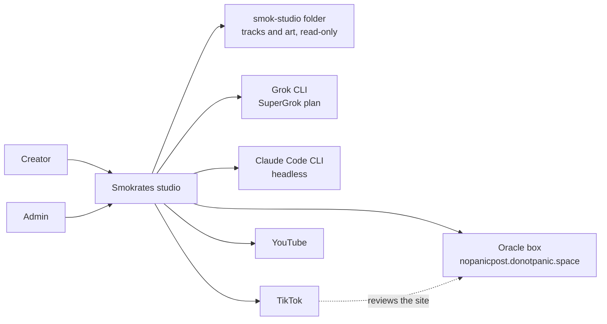
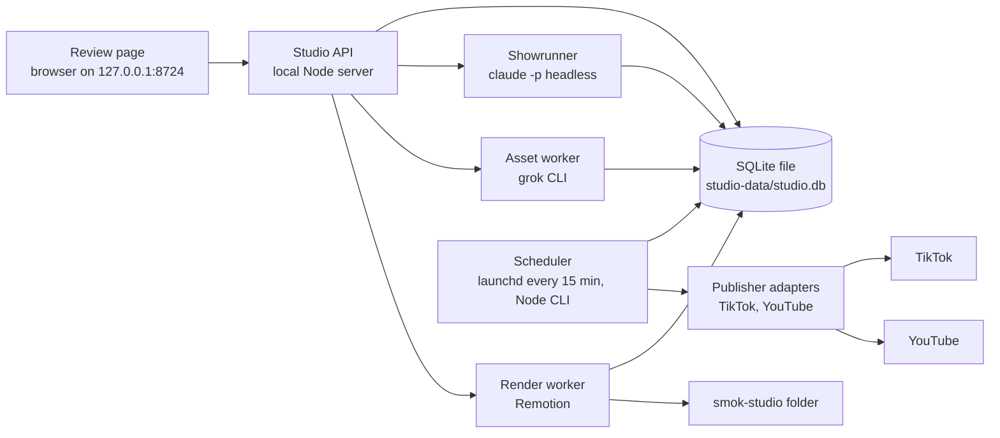

# Architecture

The map of the system. Update it in the same pull request that changes topology. History of a reversed choice lives in `docs/adr/`, marked superseded.

## What this is

The Smokrates studio makes short vertical videos for the Smokrates music project and sends them to TikTok and YouTube. Once a week a headless Claude Code run (the Showrunner) writes a plan of up to seven nights. A Grok CLI run makes the new pictures. Remotion renders each night as a 9:16 video. The Creator approves the week on one local review page. A launchd job then sends each approved night to each connected platform.

The product is for one user on one laptop. It has no accounts and no public web page of its own. The pitch is in `docs/project-guidelines.md`.

## Status of each part

| Part | State |
| --- | --- |
| Remotion render of one track (TrackCard) | Exists |
| TikTok sign-in (PKCE) and inbox draft upload | Exists. Proven in the sandbox. |
| Public site on the Oracle box, and its deploy script | Exists |
| Review demo video (ReviewDemo) | Exists |
| SQLite store, Showrunner, asset worker, new formats | Planned (cycle 1) |
| Studio API and review page | Planned (cycle 1) |
| Scheduler with originality guard | Planned (cycle 1) |
| YouTube adapter | Planned (cycle 1) |
| TikTok direct post | Later. Needs TikTok app review. |

## Context

People and external systems. C4 level 1. One box for this system.

Creator and Admin are the same person. The two names mark two kinds of work. Creator approves weeks and taps Post. Admin connects platforms and approves the man's canonical still.

## Containers

Processes, data stores, and how they talk. C4 level 2.

Each container is one local process. They share the SQLite file and the disk. The browser has one hop only: the studio API.

| Container | What it does | State |
| --- | --- | --- |
| Review page | Shows the week as one comic page. Sends the Creator's choices to the API. | Planned |
| Studio API | Validates input, reads and writes the database, starts the workers. Binds 127.0.0.1 only. | Planned |
| SQLite store | Source of truth for plans, episodes, assets, renders, publishes. | Planned |
| Render worker | Renders an episode to a 9:16 mp4 with Remotion at concurrency 2. | Exists as a CLI (render-track). Planned as a worker. |
| Asset worker | Runs the Grok CLI headless for each night that needs a new picture or clip. | Planned |
| Showrunner | Runs `claude -p` headless once a week and writes the plan. | Planned |
| Scheduler | Launchd job every 15 minutes. Runs a Node CLI that sends due, approved episodes. | Planned |
| Publisher adapters | One module per platform. TikTok inbox draft exists. | TikTok exists. YouTube planned. |

## Boundaries

- The browser talks only to the studio API. It never reads the database, the disk, or a platform.
- Only the API and the workers touch tokens. The API never returns a token. The connections list says connected or not.
- Tokens live in `.tiktok/` and `.youtube/`. Both folders are git-ignored. Files are mode 600.
- The smok-studio folder is read-only. The studio copies what it needs into ignored `public/media/<slug>/`.
- Generated pictures and clips go to ignored `assets/generated/`. Renders go to ignored `out/`.
- The API binds to 127.0.0.1. No phone or network access.
- No agent taps Post or sets a video public. Nothing is sent before the Creator approves the week.
- A render and an asset run never run at the same time. The laptop has 8 GB.
- Secrets live in `.env`. Names live in `.env.example`.

## Data

SQLite is the source of truth for plans and the publish log. Files on disk hold the media. Record-level detail is in `docs/interfaces.md`.

- Plans, episodes, assets, renders, publishes, connections and canon are tables.
- An asset row points to a file path and to its parent asset. The parent link lets the originality guard tell what is new.
- A publish row stores the platform id. An episode with a publish id is never sent twice.

## Quality

- Never post twice. Never post unapproved. Never leak a token.
- Accessibility target: WCAG 2.2 level AA, specified in `docs/accessibility.md`.
- Every operation has a test and a failure message the Creator can read.

## Decisions

`docs/adr/`. The first record is `docs/adr/0001-stack.md`.
